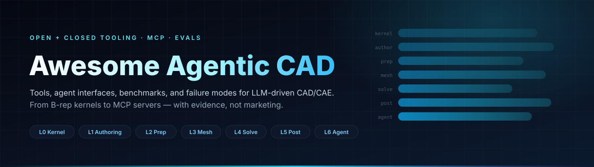

# Awesome Agentic CAD 

  

> A curated list of tools, agent interfaces, benchmarks, and failure modes for LLM-driven CAD and CAE.
>
> Agentic CAD means a closed control loop over geometric state: an agent emits actions, a deterministic verifier gates each transition, and failed states roll back. This list separates what runs from what is proven.

**English** · [简体中文](README.zh-CN.md)

## Contents

- [CAD Authoring](#cad-authoring)
- [Geometry and Interoperability](#geometry-and-interoperability)
- [Meshing](#meshing)
- [Structural and Multiphysics Solvers](#structural-and-multiphysics-solvers)
- [CFD and Explicit Dynamics](#cfd-and-explicit-dynamics)
- [Multibody Dynamics](#multibody-dynamics)
- [Post-processing and I/O](#post-processing-and-io)
- [Design Optimization](#design-optimization)
- [Agent Interfaces](#agent-interfaces)
- [MCP Servers by CAD System](#mcp-servers-by-cad-system)
- [Benchmarks and Datasets](#benchmarks-and-datasets)
- [Deep Dives](#deep-dives)
- [Commercial Tools](#commercial-tools)

## CAD Authoring

- [FreeCAD](https://github.com/FreeCAD/FreeCAD) - Parametric B-rep CAD with PartDesign, Assembly, TechDraw, FEM, and a Python API.
- [build123d](https://github.com/gumyr/build123d) - Pythonic B-rep modeling with builder and algebra modes, explicit topology objects, and STEP export.
- [CadQuery](https://github.com/CadQuery/cadquery) - Fluent Workplane API for parametric parts and constraint-based assemblies.
- [OpenSCAD](https://github.com/openscad/openscad) - Script-based CSG modeler that exports meshes, not B-rep.
- [Solvespace](https://github.com/solvespace/solvespace) - Lightweight constraint sketcher and solid modeler.
- [BRL-CAD](https://github.com/BRL-CAD/brlcad) - Long-running CSG modeling and ray-tracing system.

## Geometry and Interoperability

- [OpenCASCADE (OCCT)](https://github.com/Open-Cascade-SAS/OCCT) - Open B-rep kernel with booleans, fillets, STEP/IGES, defeaturing, and mass properties.
- [OCP](https://github.com/CadQuery/OCP) - Python bindings to OCCT used by build123d and CadQuery.
- [Analysis Situs](https://gitlab.com/ssv/AnalysisSitus) - Feature recognition, small-face detection, shape healing, and STEP inspection.
- [Salome GEOM](https://www.salome-platform.org) - Parametric geometry, healing, groups, and CAD import for simulation.
- [CAD Exchanger](https://cadexchanger.com) - Commercial multi-format CAD conversion with a batch CLI and SDK.
- [Datakit](https://www.datakit.com) - Commercial CAD data translation with per-format modules.
- [parasolid-kit](https://pypi.org/project/parasolid-kit/) - Open-source Parasolid reader that needs an external Siemens schema catalog for many files.

## Meshing

- [Gmsh](https://gitlab.onelab.info/gmsh/gmsh) - Tet, hex, pyramid, and wedge meshing with size fields, boundary layers, and a Python API.
- [Netgen](https://github.com/NGSolve/ngsolve) - Robust tetrahedral meshing integrated with the NGSolve solver stack.
- [TetGen](https://wias-berlin.de/software/tetgen/) - High-quality tetrahedral meshing with boundary recovery.
- [MMG](https://github.com/MmgTools/mmg) - Anisotropic remeshing and mesh adaptation.

## Structural and Multiphysics Solvers

- [CalculiX](https://github.com/Dhondtguido/CalculiX) - Static, modal, buckling, thermal, and contact analysis with an Abaqus-like input deck.
- [PrePoMax](https://github.com/PrePoMax/PrePoMax) - Free GUI pre- and post-processor for CalculiX, with a Python API and MCP server in version 3.
- [Code_Aster](https://gitlab.com/codeaster/codeaster) - Industrial structural, thermal, fatigue, fracture, and contact solver from EDF.
- [Salome-Meca](https://www.open-simulation-center.org/downloads/code_aster/SALOME_MECA/2025) - Integrated geometry, meshing, and Code_Aster environment distributed as a container.
- [Elmer](https://github.com/ElmerCSC/elmerfem) - Multiphysics solver covering structure, heat, flow, electromagnetics, and acoustics.
- [FEniCSx](https://github.com/FEniCS/dolfinx) - Weak-form PDE solving with Python and C++ interfaces.
- [MOOSE](https://github.com/idaholab/moose) - Fully coupled multiphysics framework with GPU backends and nuclear-grade QA.
- [deal.II](https://github.com/dealii/dealii) - Adaptive finite elements with hp-refinement and HPC support.
- [MFEM](https://github.com/mfem/mfem) - High-order finite elements with GPU and exascale support.
- [Kratos Multiphysics](https://github.com/KratosMultiphysics/Kratos) - Multiphysics application framework with FSI and DEM modules.
- [GetFEM](https://github.com/GetFEM/GetFEM) - Generic finite element library with XFEM and contact support.
- [scikit-fem](https://github.com/kinnala/scikit-fem) - Lightweight Python finite element library for prototypes and teaching.
- [FreeFEM](https://github.com/FreeFem/FreeFem-sources) - PDE domain language with 2D/3D meshing, multi-mesh interpolation, and eigenvalues.

## CFD and Explicit Dynamics

- [OpenFOAM](https://github.com/OpenFOAM/OpenFOAM-dev) - Finite-volume CFD with dictionary-driven cases and custom solvers.
- [SU2](https://github.com/su2code/SU2) - Compressible CFD and adjoint-based shape optimization.
- [code_saturne](https://github.com/code-saturne/code_saturne) - EDF's industrial CFD solver for large meshes.
- [OpenCourant](https://github.com/OpenCourant/OpenCourant) - Community continuation of OpenRadioss for explicit crash and impact analysis.

## Multibody Dynamics

- [MBDyn](https://www.mbdyn.org) - General multibody solver with flexible elements and co-simulation interfaces.
- [Project Chrono](https://github.com/projectchrono/chrono) - Multibody, FEA, granular, and fluid-solid interaction engine with a Python API.

## Post-processing and I/O

- [ParaView](https://gitlab.kitware.com/paraview/paraview) - Large-data visualization with batch Python scripting.
- [PyVista](https://github.com/pyvista/pyvista) - Python VTK wrapper with headless rendering.
- [meshio](https://github.com/nschloe/meshio) - Mesh format conversion across Gmsh, Abaqus, VTK, MED, and other formats.
- [ccx2paraview](https://github.com/calculix/ccx2paraview) - Converts CalculiX FRD results to VTK.
- [VisIt](https://github.com/visit-dav/visit) - Parallel visualization and analysis for large simulations.

## Design Optimization

- [pyMOTO](https://github.com/aatmdelissen/pyMOTO) - SIMP and robust topology optimization with thermal and overhang filters.
- [beso](https://github.com/calculix/beso) - Bi-directional evolutionary structural optimization driven by CalculiX.
- [dl4to](https://github.com/dl4to/dl4to) - PyTorch-based topology optimization with differentiable physics.
- [TopOpt](https://github.com/TopOpt/TopOpt_in_PETSc) - Educational SIMP implementation on PETSc.

## Agent Interfaces

- [build123d-mcp](https://github.com/pzfreo/build123d-mcp) - MCP server over a persistent build123d session with execute, render, measure, feature recognition, and export tools.
- [agentcad](https://github.com/jdilla1277/agentcad) - CLI and MCP server for build123d with STEP export, renders, topology inspection, and version diffs.
- [cadgen](https://github.com/earthtojake/text-to-cad) - build123d-native CAD engine with CLI, MCP, viewer, and STEP/GLB/STL/3MF/DXF export.
- [PyAnsys Common MCP](https://github.com/ansys/pyansys-common-mcp) - Apache-licensed framework for building MCP servers over PyAnsys libraries.
- [PyMechanical-MCP](https://github.com/ansys/pymechanical-mcp) - 28-tool MCP server for Ansys Mechanical sessions, scripting, solve, and results.
- [PyMAPDL-MCP](https://github.com/ansys/pymapdl-mcp) - MCP server for MAPDL command batches and Python execution.
- [PyFluent-MCP](https://github.com/ansys/pyfluent-mcp) - 20-tool MCP server for Fluent settings, solve, mesh quality, and reports.

## MCP Servers by CAD System

### FreeCAD

- [freecad-mcp](https://github.com/neka-nat/freecad-mcp) - Two-process MCP server with 17 API-level tools, arbitrary code execution, and a headless execution path.
- [freecad-ai](https://github.com/ghbalf/freecad-ai) - In-workbench agent with 64 semantic tools for bodies, sketches, assemblies, measurement, and undo.
- [freecad-robust-mcp](https://github.com/spkane/freecad-addon-robust-mcp-server) - FreeCAD addon and bridge focused on connection robustness, packaged on PyPI and Docker.

### SolidWorks

- [solidworks-automation-skill](https://github.com/wzyn20051216/solidworks-automation-skill) - Agent skill and MCP toolkit with a delivery gate that rejects stale artifacts.
- [SolidPilot](https://github.com/eyfel/mcp-server-solidworks) - Intent-level SolidWorks automation compiled through a CAD-neutral intermediate representation.
- [SolidworksMCP-TS](https://github.com/vespo92/SolidworksMCP-TS) - TypeScript MCP server for SolidWorks automation on Windows.

### Onshape

- [jarvis-onshape-mcp](https://github.com/ReshefElisha/jarvis-onshape-mcp) - Claude Code plugin for sketches, features, mates, Variable Studios, and FeatureScript, returning structured change records.
- [onshape-mcp](https://github.com/hedless/onshape-mcp) - 45-tool MCP bridge over the Onshape REST API.

### Fusion 360

- [fusion360-mcp-server](https://github.com/faust-machines/fusion360-mcp-server) - MCP server connecting coding agents to Fusion 360.
- [Fusion-360-MCP-Server](https://github.com/AuraFriday/Fusion-360-MCP-Server) - MCP control of Fusion 360 from any compatible client.

### CATIA

- [catia-v5-mcp-server](https://github.com/daiemon12/catia-v5-mcp-server) - CATIA V5 MCP server for parts, sketches, features, and native analysis.
- [CAD-Agent-Hub](https://github.com/Cai-aa/CAD-Agent-Hub) - Windows-focused hub with MCP servers for CATIA, SolidWorks, NX, and EPLAN.

### Siemens NX

- [NX_MCP](https://github.com/DreamEnding/NX_MCP) - Local NX automation with more than 47 tools over the NX GUI.

### Ansys

- [ANSYS-Workbench-mcp](https://github.com/hongwenwang36-eng/ANSYS-Workbench-mcp) - Windows bridge to SpaceClaim, Workbench, and System Coupling through journals and file-queue IPC.

### Abaqus

- [abaqus-mcp](https://github.com/Cai-aa/abaqus-mcp) - Abaqus/CAE plugin with file-based IPC, job submission, ODB inspection, and viewport capture.
- [Abaqus-Control-MCP](https://github.com/Whfkl/Abaqus-Control-MCP) - Real-time Abaqus/CAE control bridge for MCP clients.
- [abaqus-mcp-server](https://github.com/jianzhichun/abaqus-mcp-server) - MCP server for an already running Abaqus/CAE GUI.

### COMSOL

- [COMSOL_Multiphysics_MCP](https://github.com/wjc9011/COMSOL_Multiphysics_MCP) - COMSOL automation through the Java API with a published paper.
- [comsol-mcp](https://github.com/777gegewu/comsol-mcp) - Learning-oriented COMSOL MCP controlling an open Desktop GUI through Java Shell.

### OpenFOAM

- [openfoam-mcp-server](https://github.com/webworn/openfoam-mcp-server) - OpenFOAM MCP with case setup, error resolution, and CFD education features.

### CAE Platforms

- [CAE-Agent-Hub](https://github.com/Cai-aa/CAE-Agent-Hub) - MCP tools, skills, and result viewers for modeling, meshing, solving, and post-processing.
- [FieldCraft](https://github.com/tangency-labs/fieldcraft) - Clean-room CAE in Rust with tet/hex meshing, implicit and explicit solvers, and MCP.
- [sim-cli](https://github.com/svd-ai-lab/sim-cli) - Parses existing CAE files into bounded structured text for agents without launching a solver.

## Benchmarks and Datasets

- [Text2CAD-Bench](https://arxiv.org/html/2605.18430) - 600 CAD examples and 1,200 prompts scored by Chamfer distance, invalidity rate, and IoU.
- [CADGenBench](https://github.com/huggingface/cadgenbench) - Validity-gated generation and editing benchmark with topology and mating-feature checks.
- [CAD-Assistant](https://cadassistant.github.io/) - Tool-augmented VLLM framework evaluated on 2D/3D CAD QA, auto-constraining, and sketch parameterization.
- [FEABench](https://arxiv.org/abs/2504.06260) - End-to-end finite element tasks executed through the COMSOL Java API.
- [FEM-Bench](https://doi.org/10.1007/s00366-026-02397-z) - Computational mechanics code and test generation benchmark with 33 tasks.
- [MecEng](https://arxiv.org/abs/2608.14615) - 84 multibody modeling tasks spanning rigid and flexible systems with graph and eigenfrequency checks.
- [SCBench](https://arxiv.org/html/2604.09594v1) - 285 spatial reasoning subtasks graded by deterministic verifiers and simulators.
- [EngiBench](https://aclanthology.org/2026.findings-acl.1810/) - Hierarchical engineering problem-solving benchmark with perturbed and knowledge-enhanced variants.
- [EngiAI](https://arxiv.org/html/2605.19743v3) - Capability-based evaluation of tool-connected engineering agents.
- [MechVQA](https://arxiv.org/html/2605.30794v2) - 3,281 mechanical drawings and 21K questions on recognition, reasoning, and standards judgment.
- [Text2CAD dataset](https://github.com/SadilKhan/Text2CAD) - NeurIPS 2024 dataset and model for sequential CAD generation from text prompts.

## Deep Dives

- [Tool catalog](https://github.com/Misaka0x26FE/Awesome-Agentic-CAD/blob/main/docs/tool-catalog.md) - Versions, licenses, agent surfaces, and headless capability for every listed tool.
- [Agent ecosystem](https://github.com/Misaka0x26FE/Awesome-Agentic-CAD/blob/main/docs/agent-ecosystem.md) - Star thresholds, maintenance status, and interface details for 36 agent projects.
- [Agent interfaces](https://github.com/Misaka0x26FE/Awesome-Agentic-CAD/blob/main/docs/agent-interfaces.md) - MCP, CLI, Python, and file contracts with error codes, gates, and sandboxing.
- [Benchmarks](https://github.com/Misaka0x26FE/Awesome-Agentic-CAD/blob/main/docs/benchmarks.md) - Metric definitions, results, threats to validity, and evidence grading.
- [Limitations](https://github.com/Misaka0x26FE/Awesome-Agentic-CAD/blob/main/docs/limitations.md) - Twelve failure mechanisms with observables, mitigations, and residual risk.
- [Reference architecture](https://github.com/Misaka0x26FE/Awesome-Agentic-CAD/blob/main/docs/reference-architecture.md) - State machine, JSON schemas, rollback, determinism, and anti-patterns.

## Commercial Tools

- [SolidWorks](https://www.solidworks.com) - Windows-only parametric CAD built on Parasolid with a COM automation API.
- [Siemens NX](https://plm.sw.siemens.com/en-US/nx/) - High-end CAD, CAM, and CAE platform with NX Open automation.
- [Creo](https://www.ptc.com/en/products/creo) - Parametric CAD with the Granite kernel and a C/C++ toolkit.
- [CATIA](https://www.3ds.com/products/catia) - Dassault's CGM-based platform for surfacing and large assemblies.
- [Inventor](https://www.autodesk.com/products/inventor) - Autodesk mechanical CAD with iLogic and .NET automation.
- [Solid Edge](https://solidedge.siemens.com) - Synchronous and ordered modeling with a Parasolid kernel.
- [Fusion](https://www.autodesk.com/products/fusion-360) - Cloud-connected CAD, CAM, and CAE with Python and C++ APIs.
- [Onshape](https://www.onshape.com) - Browser CAD with built-in PDM, FeatureScript, and a REST API.
- [SpaceClaim](https://www.ansys.com/products/3d-design/ansys-spaceclaim) - Direct modeling and geometry cleanup for simulation.
- [Ansys Mechanical](https://www.ansys.com/products/structures/ansys-mechanical) - Structural, thermal, modal, and coupled analysis.
- [Ansys Fluent](https://www.ansys.com/products/fluids/ansys-fluent) - General-purpose CFD with PyFluent automation.
- [Abaqus](https://www.3ds.com/products/simulia/abaqus) - Nonlinear structural and explicit dynamics solver.
- [COMSOL Multiphysics](https://www.comsol.com) - Coupled PDE and multiphysics simulation with a Java API.
- [Simcenter 3D](https://plm.sw.siemens.com/en-US/simcenter/mechanical-simulation/simcenter-3d/) - Structural dynamics, acoustics, and durability.
- [HyperMesh](https://www.siemens.com/en-us/products/simcenter/simulation-modeling-visualization/hypermesh/) - Pre-processing, batch meshing, and solver decks.
- [ANSA](https://www.cadence.com/en_US/home/tools/engineering-simulation/ansa-preprocessor.html) - Geometry cleanup and batch meshing for multiple solvers.
- [SimScale](https://www.simscale.com) - Cloud CFD, FEA, and thermal simulation with a REST API.
- [MSC Nastran](https://www.cadence.com/en_US/home/tools/engineering-simulation/msc-nastran.html) - Linear, dynamic, and aeroelastic structural analysis.
- [LS-DYNA](https://www.ansys.com/products/structures/ansys-ls-dyna) - Explicit crash, impact, and forming simulation.
- [Tecplot 360](https://www.tecplot.com) - Engineering plotting and post-processing.
- [OptiStruct](https://altair.com/optistruct) - Industrial topology, shape, and size optimization.
- [Tosca](https://www.3ds.com/products/simulia/tosca) - Topology and shape optimization for Abaqus workflows.
- [Inspire](https://altair.com/inspire) - Concept-level generative design and topology optimization.

## Contributing

Contributions are welcome. Read [contributing.md](contributing.md) for inclusion criteria, star thresholds, evidence requirements, and the review checklist.

---

[MIT](LICENSE) © 2026 Misaka0x26FE and contributors.
