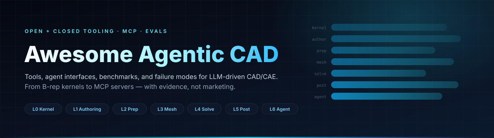

# Awesome Agentic CAD 

  

> 面向 LLM 驱动 CAD/CAE 的精选列表：工具、agent 接口、评测证据与失效模式。
>
> Agentic CAD 指几何状态上的闭环控制：agent 发出动作，确定性校验器门控每次迁移，失败状态可回滚。本列表把「能跑」与「被证明」分开写。

[English](README.md) · **简体中文**

## 目录

- [CAD 建模](#cad-建模)
- [几何与互操作](#几何与互操作)
- [网格](#网格)
- [结构与多物理求解器](#结构与多物理求解器)
- [CFD 与显式动力学](#cfd-与显式动力学)
- [多体动力学](#多体动力学)
- [后处理与 I/O](#后处理与-io)
- [设计优化](#设计优化)
- [Agent 接口](#agent-接口)
- [按 CAD 系统划分的 MCP server](#按-cad-系统划分的-mcp-server)
- [Benchmark 与数据集](#benchmark-与数据集)
- [深度阅读](#深度阅读)
- [商业工具](#商业工具)

## CAD 建模

- [FreeCAD](https://github.com/FreeCAD/FreeCAD) - 参数化 B-rep CAD，含 PartDesign、Assembly、TechDraw、FEM 与 Python API。
- [build123d](https://github.com/gumyr/build123d) - Python 风格的 B-rep 建模，支持 builder 与代数两种写法、显式拓扑对象与 STEP 导出。
- [CadQuery](https://github.com/CadQuery/cadquery) - 链式 Workplane API，用于参数化零件与带约束装配。
- [OpenSCAD](https://github.com/openscad/openscad) - 脚本化 CSG 建模器，输出网格而非 B-rep。
- [Solvespace](https://github.com/solvespace/solvespace) - 轻量约束草图与实体建模器。
- [BRL-CAD](https://github.com/BRL-CAD/brlcad) - 长期维护的 CSG 建模与光线追踪系统。

## 几何与互操作

- [OpenCASCADE (OCCT)](https://github.com/Open-Cascade-SAS/OCCT) - 开源 B-rep 内核，含布尔、圆角、STEP/IGES、去特征与质量属性。
- [OCP](https://github.com/CadQuery/OCP) - build123d 与 CadQuery 使用的 OCCT Python 绑定。
- [Analysis Situs](https://gitlab.com/ssv/AnalysisSitus) - 特征识别、小面检测、形状愈合与 STEP 检查。
- [Salome GEOM](https://www.salome-platform.org) - 面向仿真的参数化几何、愈合、分组与 CAD 导入。
- [CAD Exchanger](https://cadexchanger.com) - 商业多格式 CAD 转换，提供批处理 CLI 与 SDK。
- [Datakit](https://www.datakit.com) - 商业 CAD 数据翻译，按格式模块授权。
- [parasolid-kit](https://pypi.org/project/parasolid-kit/) - 开源 Parasolid 读取器，多数文件需要外部 Siemens schema catalog。

## 网格

- [Gmsh](https://gitlab.onelab.info/gmsh/gmsh) - 四面体/六面体/棱锥/棱柱网格，支持尺寸场、边界层与 Python API。
- [Netgen](https://github.com/NGSolve/ngsolve) - 稳健的四面体网格，与 NGSolve 求解栈集成。
- [TetGen](https://wias-berlin.de/software/tetgen/) - 高质量四面体网格与边界恢复。
- [MMG](https://github.com/MmgTools/mmg) - 各向异性重网格与网格自适应。

## 结构与多物理求解器

- [CalculiX](https://github.com/Dhondtguido/CalculiX) - 静力、模态、屈曲、热与接触分析，输入卡接近 Abaqus。
- [PrePoMax](https://github.com/PrePoMax/PrePoMax) - CalculiX 的免费图形前后处理，3.0 起提供 Python API 与 MCP server。
- [Code_Aster](https://gitlab.com/codeaster/codeaster) - EDF 的工业级结构、热、疲劳、断裂与接触求解器。
- [Salome-Meca](https://www.open-simulation-center.org/downloads/code_aster/SALOME_MECA/2025) - 几何、网格与 Code_Aster 一体化环境，以容器分发。
- [Elmer](https://github.com/ElmerCSC/elmerfem) - 覆盖结构、热、流动、电磁与声学的多物理求解器。
- [FEniCSx](https://github.com/FEniCS/dolfinx) - 弱形式 PDE 求解，提供 Python 与 C++ 接口。
- [MOOSE](https://github.com/idaholab/moose) - 全耦合多物理框架，支持 GPU 后端与核级 QA。
- [deal.II](https://github.com/dealii/dealii) - 自适应有限元，支持 hp 加密与 HPC。
- [MFEM](https://github.com/mfem/mfem) - 高阶有限元，支持 GPU 与超大规模。
- [Kratos Multiphysics](https://github.com/KratosMultiphysics/Kratos) - 多物理应用框架，含 FSI 与 DEM 模块。
- [GetFEM](https://github.com/GetFEM/GetFEM) - 通用有限元库，支持 XFEM 与接触。
- [scikit-fem](https://github.com/kinnala/scikit-fem) - 轻量 Python 有限元库，适合原型与教学。
- [FreeFEM](https://github.com/FreeFem/FreeFem-sources) - PDE 领域语言，支持 2D/3D 网格、多网格插值与特征值。

## CFD 与显式动力学

- [OpenFOAM](https://github.com/OpenFOAM/OpenFOAM-dev) - 有限体积 CFD，字典驱动算例与自定义求解器。
- [SU2](https://github.com/su2code/SU2) - 可压缩 CFD 与伴随形状优化。
- [code_saturne](https://github.com/code-saturne/code_saturne) - EDF 的工业 CFD 求解器，面向大网格。
- [OpenCourant](https://github.com/OpenCourant/OpenCourant) - OpenRadioss 的社区延续，用于显式碰撞与冲击分析。

## 多体动力学

- [MBDyn](https://www.mbdyn.org) - 通用多体求解器，支持柔性体与联合仿真接口。
- [Project Chrono](https://github.com/projectchrono/chrono) - 多体、有限元、颗粒与流固耦合引擎，提供 Python API。

## 后处理与 I/O

- [ParaView](https://gitlab.kitware.com/paraview/paraview) - 大数据可视化，支持批处理 Python 脚本。
- [PyVista](https://github.com/pyvista/pyvista) - Python VTK 封装，支持无头渲染。
- [meshio](https://github.com/nschloe/meshio) - Gmsh、Abaqus、VTK、MED 等网格格式互转。
- [ccx2paraview](https://github.com/calculix/ccx2paraview) - 将 CalculiX FRD 结果转为 VTK。
- [VisIt](https://github.com/visit-dav/visit) - 面向大规模仿真的并行可视化与分析。

## 设计优化

- [pyMOTO](https://github.com/aatmdelissen/pyMOTO) - SIMP 与鲁棒拓扑优化，支持热与悬垂过滤。
- [beso](https://github.com/calculix/beso) - 双向渐进结构优化，由 CalculiX 驱动。
- [dl4to](https://github.com/dl4to/dl4to) - 基于 PyTorch 的可微物理拓扑优化。
- [TopOpt](https://github.com/TopOpt/TopOpt_in_PETSc) - PETSc 上的教学级 SIMP 实现。

## Agent 接口

- [build123d-mcp](https://github.com/pzfreo/build123d-mcp) - 持久 build123d 会话上的 MCP server，提供执行、渲染、测量、特征识别与导出工具。
- [agentcad](https://github.com/jdilla1277/agentcad) - build123d 的 CLI 与 MCP server，支持 STEP 导出、渲染、拓扑检查与版本 diff。
- [cadgen](https://github.com/earthtojake/text-to-cad) - build123d 原生 CAD 引擎，提供 CLI、MCP、viewer 与 STEP/GLB/STL/3MF/DXF 导出。
- [PyAnsys Common MCP](https://github.com/ansys/pyansys-common-mcp) - 基于 PyAnsys 构建 MCP server 的 Apache 许可框架。
- [PyMechanical-MCP](https://github.com/ansys/pymechanical-mcp) - 面向 Ansys Mechanical 的 28 工具 MCP server，覆盖会话、脚本、求解与结果。
- [PyMAPDL-MCP](https://github.com/ansys/pymapdl-mcp) - 面向 MAPDL 命令批处理与 Python 执行的 MCP server。
- [PyFluent-MCP](https://github.com/ansys/pyfluent-mcp) - 面向 Fluent 设置、求解、网格质量与报告的 20 工具 MCP server。

## 按 CAD 系统划分的 MCP server

### FreeCAD

- [freecad-mcp](https://github.com/neka-nat/freecad-mcp) - 双进程 MCP server，17 个 API 级工具，支持任意代码执行与无头执行路径。
- [freecad-ai](https://github.com/ghbalf/freecad-ai) - 工作台内 agent，64 个语义工具，覆盖实体、草图、装配、测量与撤销。
- [freecad-robust-mcp](https://github.com/spkane/freecad-addon-robust-mcp-server) - 面向连接稳健性的 FreeCAD addon 与 bridge，提供 PyPI 与 Docker 包。

### SolidWorks

- [solidworks-automation-skill](https://github.com/wzyn20051216/solidworks-automation-skill) - agent skill 与 MCP 工具包，带交付门禁，拒绝过期产物。
- [SolidPilot](https://github.com/eyfel/mcp-server-solidworks) - 意图级 SolidWorks 自动化，经 CAD 中立中间表示编译为 API 调用。
- [SolidworksMCP-TS](https://github.com/vespo92/SolidworksMCP-TS) - Windows 上的 TypeScript SolidWorks MCP server。

### Onshape

- [jarvis-onshape-mcp](https://github.com/ReshefElisha/jarvis-onshape-mcp) - Claude Code 插件，支持草图、特征、配合、Variable Studios 与 FeatureScript，并返回结构化变更记录。
- [onshape-mcp](https://github.com/hedless/onshape-mcp) - 基于 Onshape REST API 的 45 工具 MCP bridge。

### Fusion 360

- [fusion360-mcp-server](https://github.com/faust-machines/fusion360-mcp-server) - 将编码 agent 连接到 Fusion 360 的 MCP server。
- [Fusion-360-MCP-Server](https://github.com/AuraFriday/Fusion-360-MCP-Server) - 从任意 MCP 客户端控制 Fusion 360。

### CATIA

- [catia-v5-mcp-server](https://github.com/daiemon12/catia-v5-mcp-server) - CATIA V5 MCP server，覆盖零件、草图、特征与原生分析。
- [CAD-Agent-Hub](https://github.com/Cai-aa/CAD-Agent-Hub) - Windows 导向的 hub，含 CATIA、SolidWorks、NX 与 EPLAN 的 MCP server。

### Siemens NX

- [NX_MCP](https://github.com/DreamEnding/NX_MCP) - 通过 NX GUI 提供 47+ 工具的本地自动化。

### Ansys

- [ANSYS-Workbench-mcp](https://github.com/hongwenwang36-eng/ANSYS-Workbench-mcp) - 通过 journal 与文件队列 IPC 连接 SpaceClaim、Workbench 与 System Coupling 的 Windows bridge。

### Abaqus

- [abaqus-mcp](https://github.com/Cai-aa/abaqus-mcp) - Abaqus/CAE 插件，基于文件 IPC，支持作业提交、ODB 检查与视口截图。
- [Abaqus-Control-MCP](https://github.com/Whfkl/Abaqus-Control-MCP) - 面向 MCP 客户端的实时 Abaqus/CAE 控制 bridge。
- [abaqus-mcp-server](https://github.com/jianzhichun/abaqus-mcp-server) - 面向已运行 Abaqus/CAE GUI 的 MCP server。

### COMSOL

- [COMSOL_Multiphysics_MCP](https://github.com/wjc9011/COMSOL_Multiphysics_MCP) - 通过 Java API 的 COMSOL 自动化，附发表论文。
- [comsol-mcp](https://github.com/777gegewu/comsol-mcp) - 学习导向的 COMSOL MCP，通过 Java Shell 控制已打开的 Desktop GUI。

### OpenFOAM

- [openfoam-mcp-server](https://github.com/webworn/openfoam-mcp-server) - OpenFOAM MCP，支持算例设置、错误排查与 CFD 教学功能。

### CAE 平台

- [CAE-Agent-Hub](https://github.com/Cai-aa/CAE-Agent-Hub) - 面向建模、网格、求解与后处理的 MCP 工具、skill 与结果查看器。
- [FieldCraft](https://github.com/tangency-labs/fieldcraft) - Rust 编写的 clean-room CAE，含四面体/六面体网格、隐式与显式求解器及 MCP。
- [sim-cli](https://github.com/svd-ai-lab/sim-cli) - 将现有 CAE 文件解析为有界结构化文本，供 agent 使用且不启动求解器。

## Benchmark 与数据集

- [Text2CAD-Bench](https://arxiv.org/html/2605.18430) - 600 个 CAD 样例与 1,200 条 prompt，用 Chamfer 距离、无效代码率与 IoU 评分。
- [CADGenBench](https://github.com/huggingface/cadgenbench) - 有效性门控的生成与编辑 benchmark，含拓扑与配合特征检查。
- [CAD-Assistant](https://cadassistant.github.io/) - 工具增强 VLLM 框架，在 2D/3D CAD 问答、自动约束与草图参数化上评测。
- [FEABench](https://arxiv.org/abs/2504.06260) - 通过 COMSOL Java API 执行的端到端有限元任务。
- [FEM-Bench](https://doi.org/10.1007/s00366-026-02397-z) - 33 个任务的计算力学代码与测试生成 benchmark。
- [MecEng](https://arxiv.org/abs/2608.14615) - 84 个多体建模任务，覆盖刚体与柔性系统，含图同构与特征频率检查。
- [SCBench](https://arxiv.org/html/2604.09594v1) - 285 个空间推理子任务，由确定性校验器与模拟器评分。
- [EngiBench](https://aclanthology.org/2026.findings-acl.1810/) - 分层工程问题求解 benchmark，含扰动与知识增强变体。
- [EngiAI](https://arxiv.org/html/2605.19743v3) - 面向工具连接工程 agent 的能力化评测。
- [MechVQA](https://arxiv.org/html/2605.30794v2) - 3,281 张机械图纸与 21K 问题，覆盖识别、推理与标准判断。
- [Text2CAD 数据集](https://github.com/SadilKhan/Text2CAD) - NeurIPS 2024 的序列 CAD 生成数据集与模型。

## 深度阅读

- [工具目录](https://github.com/Misaka0x26FE/Awesome-Agentic-CAD/blob/main/docs/tool-catalog.md) - 每个工具的版本、许可证、agent 接口与无头能力。
- [Agent 生态](https://github.com/Misaka0x26FE/Awesome-Agentic-CAD/blob/main/docs/agent-ecosystem.md) - 36 个 agent 项目的 star 阈值、维护状态与接口细节。
- [Agent 接口](https://github.com/Misaka0x26FE/Awesome-Agentic-CAD/blob/main/docs/agent-interfaces.md) - MCP、CLI、Python 与文件契约，含错误码、校验门与沙箱。
- [评测](https://github.com/Misaka0x26FE/Awesome-Agentic-CAD/blob/main/docs/benchmarks.md) - 指标定义、结果、效度威胁与证据分级。
- [局限](https://github.com/Misaka0x26FE/Awesome-Agentic-CAD/blob/main/docs/limitations.md) - 十二个失效机制，含观测、缓解与残余风险。
- [参考架构](https://github.com/Misaka0x26FE/Awesome-Agentic-CAD/blob/main/docs/reference-architecture.md) - 状态机、JSON schema、回滚、确定性与反模式。

## 商业工具

- [SolidWorks](https://www.solidworks.com) - 基于 Parasolid 的 Windows 参数化 CAD，提供 COM 自动化 API。
- [Siemens NX](https://plm.sw.siemens.com/en-US/nx/) - 高端 CAD/CAM/CAE 平台，提供 NX Open 自动化。
- [Creo](https://www.ptc.com/en/products/creo) - 基于 Granite 内核的参数化 CAD，提供 C/C++ toolkit。
- [CATIA](https://www.3ds.com/products/catia) - Dassault 基于 CGM 的曲面与大型装配平台。
- [Inventor](https://www.autodesk.com/products/inventor) - Autodesk 机械 CAD，支持 iLogic 与 .NET 自动化。
- [Solid Edge](https://solidedge.siemens.com) - 同步与顺序建模，基于 Parasolid 内核。
- [Fusion](https://www.autodesk.com/products/fusion-360) - 云端协同的 CAD/CAM/CAE，提供 Python 与 C++ API。
- [Onshape](https://www.onshape.com) - 浏览器 CAD，内置 PDM、FeatureScript 与 REST API。
- [SpaceClaim](https://www.ansys.com/products/3d-design/ansys-spaceclaim) - 直接建模与仿真前几何清理。
- [Ansys Mechanical](https://www.ansys.com/products/structures/ansys-mechanical) - 结构、热、模态与耦合分析。
- [Ansys Fluent](https://www.ansys.com/products/fluids/ansys-fluent) - 通用 CFD，支持 PyFluent 自动化。
- [Abaqus](https://www.3ds.com/products/simulia/abaqus) - 非线性结构与显式动力学求解器。
- [COMSOL Multiphysics](https://www.comsol.com) - 耦合 PDE 与多物理仿真，提供 Java API。
- [Simcenter 3D](https://plm.sw.siemens.com/en-US/simcenter/mechanical-simulation/simcenter-3d/) - 结构动力学、声学与耐久性。
- [HyperMesh](https://www.siemens.com/en-us/products/simcenter/simulation-modeling-visualization/hypermesh/) - 前处理、批量网格与求解器 deck。
- [ANSA](https://www.cadence.com/en_US/home/tools/engineering-simulation/ansa-preprocessor.html) - 面向多求解器的几何清理与批量网格。
- [SimScale](https://www.simscale.com) - 云端 CFD、FEA 与热仿真，提供 REST API。
- [MSC Nastran](https://www.cadence.com/en_US/home/tools/engineering-simulation/msc-nastran.html) - 线性、动力与气动弹性结构分析。
- [LS-DYNA](https://www.ansys.com/products/structures/ansys-ls-dyna) - 显式碰撞、冲击与成形仿真。
- [Tecplot 360](https://www.tecplot.com) - 工程绘图与后处理。
- [OptiStruct](https://altair.com/optistruct) - 工业级拓扑、形状与尺寸优化。
- [Tosca](https://www.3ds.com/products/simulia/tosca) - 面向 Abaqus 工作流的拓扑与形状优化。
- [Inspire](https://altair.com/inspire) - 概念级生成式设计与拓扑优化。

## 贡献

欢迎贡献。收录标准、star 阈值、证据要求与 review checklist 见 [contributing.md](contributing.md)。

---

[MIT](license) © 2026 Misaka0x26FE 与贡献者。
